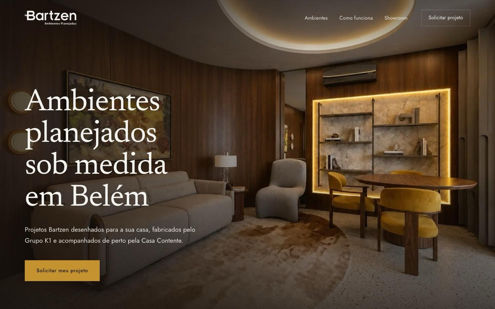
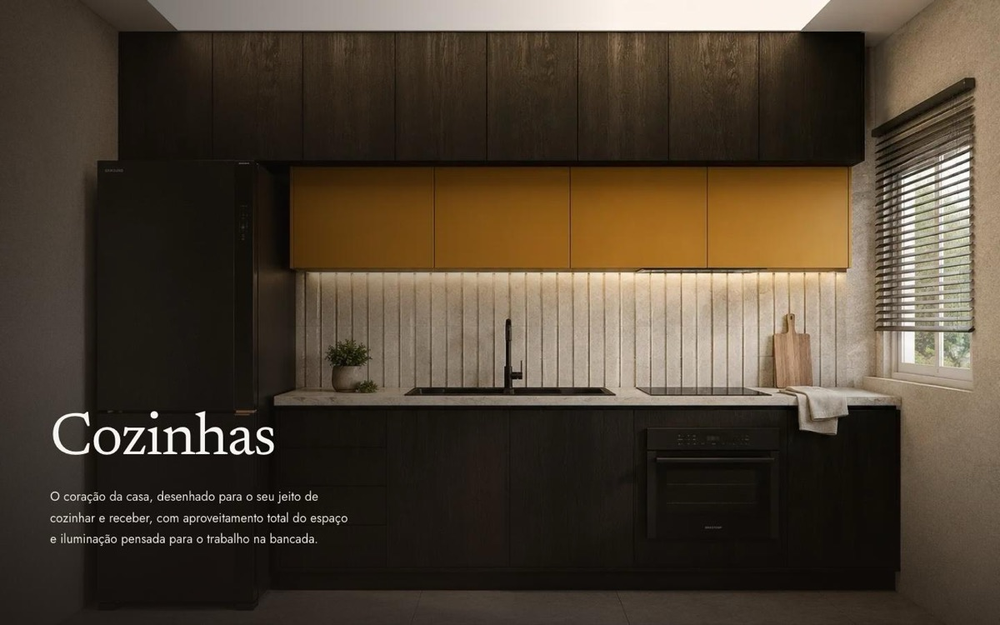
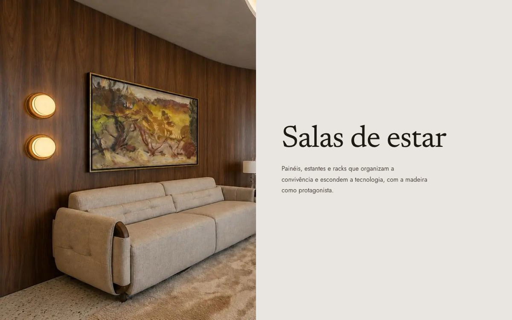
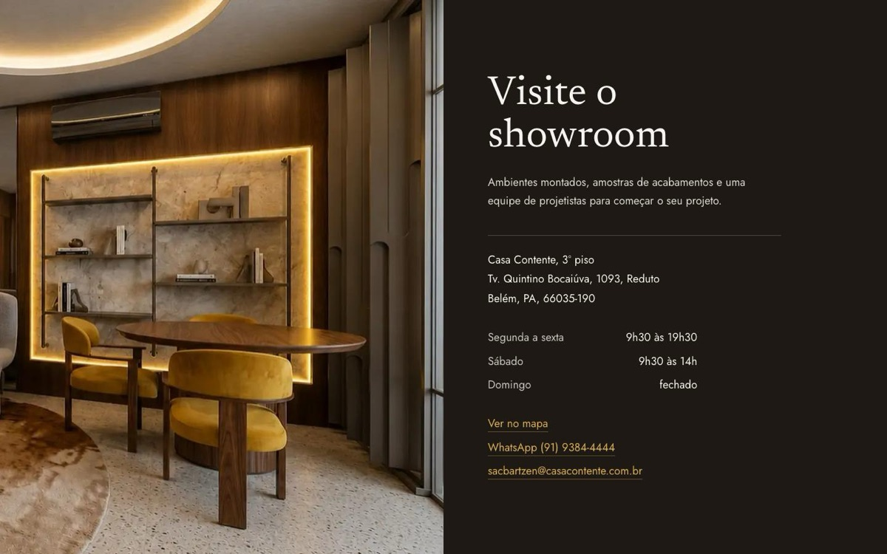
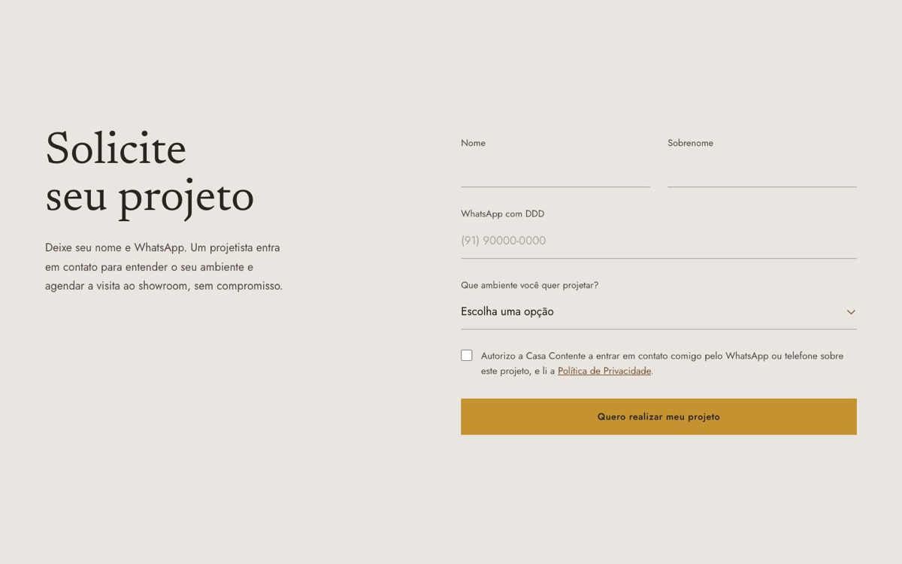
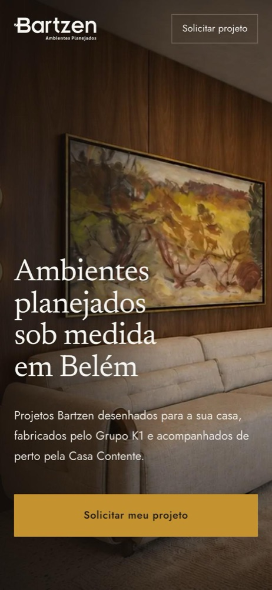
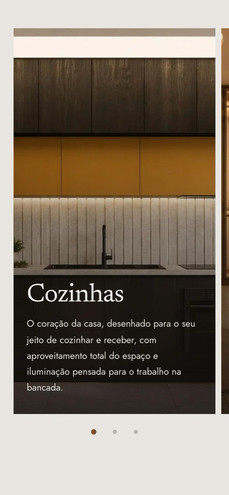
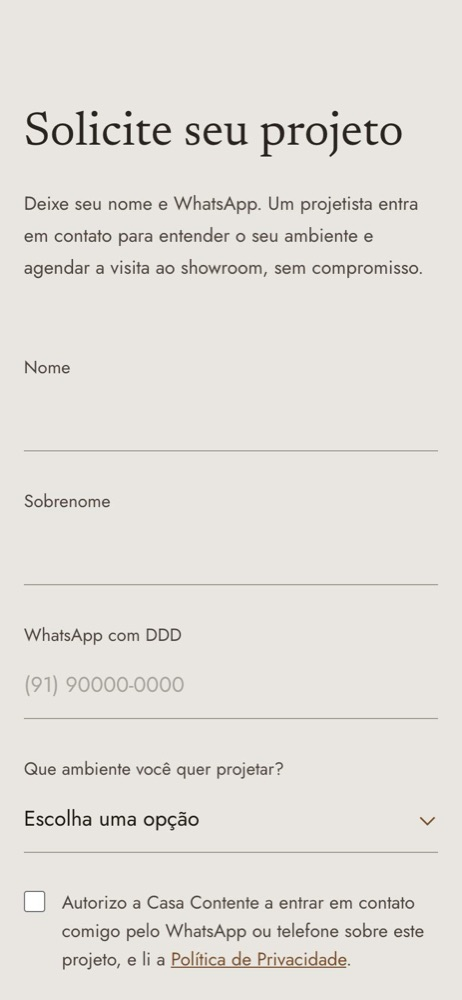

# Bartzen Belém

Site da **Bartzen Belém**, representada pela Casa Contente: ambientes planejados sob medida, showroom em Belém e formulário de solicitação de projeto.

**No ar:** https://bartzen.casacontente.com.br



## Prints

### Computador

Cada seção ocupa a tela inteira e a rolagem encaixa de uma na outra, com uma transição leve (o texto aparece e a foto "assenta").

| Cozinhas | Salas de estar |
|---|---|
|  |  |

| Showroom | Formulário |
|---|---|
|  |  |

### Celular

Rolagem livre; cozinhas, closets e salas viram um carrossel de deslizar para o lado.

| Topo | Carrossel dos ambientes | Formulário |
|---|---|---|
|  |  |  |

## Como é feito

- **Node.js + Express** (`server.js`): serve só a pasta `public/` e a rota do formulário.
- **HTML, CSS e JavaScript puros**, sem framework e sem etapa de build.
- **Fontes hospedadas no próprio site** (Newsreader nos títulos e Jost no texto, licença OFL em `public/fontes/`): nenhuma chamada ao Google Fonts.
- **Fotos em WebP com JPG de reserva**, com versões menores para o celular.

```
server.js            servidor Express: arquivos de public/, /api/config e /api/lead
api/lead.js          recebe o formulário, valida e repassa o pedido ao sistema interno
public/
  index.html         página principal
  privacidade.html   Política de Privacidade (LGPD)
  404.html           página não encontrada
  css/site.css       estilos do site
  js/script.js       formulário, origem da visita, captcha e aviso de cookies
  js/telas.js        transição entre as seções e carrossel do celular
  img/  fontes/      fotos, logo e fontes
docs/prints/         prints usados neste README
```

## Rodar localmente

Precisa de Node.js 20 ou mais novo.

```bash
npm install
npm start            # http://localhost:3000
```

Sem as variáveis do formulário, o site abre normalmente e o envio responde "Serviço indisponível no momento".

## Variáveis de ambiente

Configuradas no Render (Environment do serviço). Nunca coloque os valores no código nem neste repositório.

| Variável | Obrigatória | Para que serve |
|---|---|---|
| `KANBAN_URL` | sim | endereço do sistema interno que recebe os pedidos do formulário |
| `KANBAN_TOKEN` | sim | chave de acesso a esse sistema |
| `TURNSTILE_SITE_KEY` e `TURNSTILE_SECRET_KEY` | não | captcha do Cloudflare no formulário |
| `GA4_ID` | não | Google Analytics 4 (formato `G-XXXXXXX`) |
| `META_PIXEL_ID` | não | Pixel da Meta |

Sem as opcionais, o recurso correspondente fica desligado. Com GA4 ou Pixel, aparece um aviso de cookies e a medição só carrega depois do aceite.

## Formulário de solicitação de projeto

1. O navegador valida nome, WhatsApp e o aceite da Política de Privacidade.
2. `api/lead.js` repete a validação, descarta robôs (campo isca e captcha opcional), limita a 5 envios por IP a cada 10 minutos e repassa o pedido ao sistema interno da Casa Contente, onde ele vira um card no kanban dos planejados.
3. Junto com o pedido vão a **prova do aceite** (texto da caixa marcada e versão da política) e a **origem da visita** (parâmetros `utm_*`, clique em anúncio do Google ou link do Facebook/Instagram, site de onde veio).

Ao mudar o texto da caixa de aceite ou a data da política, atualize as constantes `ACEITE_TEXTO` e `POLITICA_VERSAO` no topo de `api/lead.js`.

Para os anúncios aparecerem pelo nome no card, use links com UTM:

```
https://bartzen.casacontente.com.br/?utm_source=instagram&utm_medium=cpc&utm_campaign=black-friday
```

## Publicação

O Render publica sozinho a cada push na `main` (cerca de 1 minuto). O domínio passa pelo Cloudflare.

## Pendências

Estão nas [issues](https://github.com/lvdamaceno/bartzen-site/issues).
